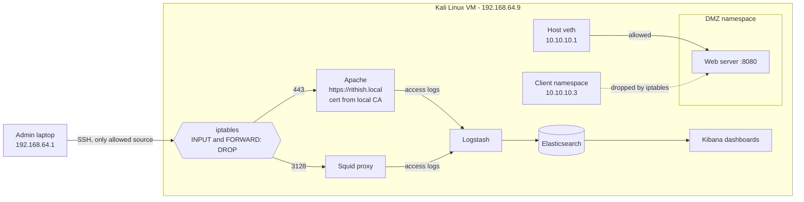
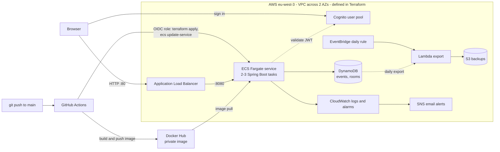
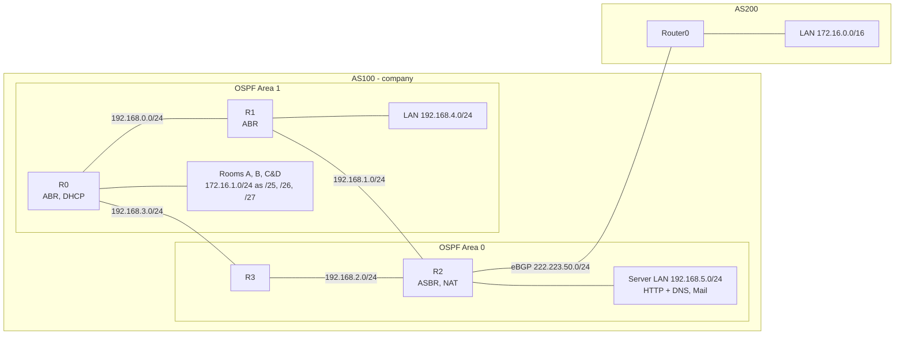
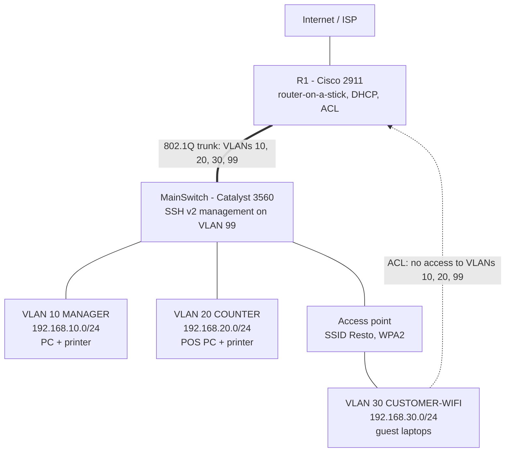

# Network & Security Projects

Hands-on projects in network engineering, security and cloud infrastructure. Each folder holds a PDF report. The two Cisco projects also include every router and switch configuration as plain text (`show running-config`) and the Packet Tracer file.

| Project | Stack | Report |
| --- | --- | --- |
| [Secure network services lab](#secure-network-services-lab) | Apache, OpenSSL CA, ELK Stack, Squid, iptables | [PDF](secure-network-services-lab/Secure_Network_Services_Lab_Report.pdf) |
| [Campus occupancy dashboard](#campus-occupancy-dashboard) | AWS ECS Fargate, ALB, DynamoDB, Cognito, Terraform, GitHub Actions | [PDF](campus-occupancy-dashboard/Campus_Occupancy_Dashboard_Report.pdf) |
| [Enterprise network architecture](#enterprise-network-architecture) | Cisco: multi-area OSPF, eBGP, VLSM, DHCP, NAT, ACL | [PDF](enterprise-network-architecture/Enterprise_Network_Architecture_Report.pdf) |
| [Resto Network](#resto-network) | Cisco: VLANs, router-on-a-stick, ACL, SSH, WPA2 Wi-Fi | [PDF](resto-network/Resto_Network_Report.pdf) |

---

## Secure network services lab

On one Kali Linux VM, I served the local domain `rithish.local` over HTTPS with Apache, using a server certificate signed by my own OpenSSL certificate authority and verified with OpenSSL, curl and Firefox. Apache and Squid proxy logs go through Logstash into Elasticsearch 7.17, where Kibana searches and charts them. A DMZ is simulated with a Linux network namespace joined by a veth pair: iptables lets only the host reach the DMZ web server on port 8080 and drops traffic from a second "client" namespace. The host firewall sets INPUT and FORWARD to DROP, allows SSH only from the admin machine, and is saved with netfilter-persistent.

**Files:** [Report (PDF)](secure-network-services-lab/Secure_Network_Services_Lab_Report.pdf)

---

## Campus occupancy dashboard

A team project (4 people): a Spring Boot API and dashboard that track room occupancy across a campus, deployed on AWS in Paris (eu-west-3). Two to three ECS Fargate tasks run behind an Application Load Balancer across two availability zones and scale on CPU. Users sign in with Cognito and the API checks their JWT on every request; data sits in DynamoDB and an EventBridge-triggered Lambda exports it to S3 every day. All infrastructure is Terraform with remote state in S3, and GitHub Actions builds the image, applies Terraform and redeploys ECS through OIDC, with no stored AWS keys. The compute layer started on EC2 with an Auto Scaling Group and was migrated to Fargate after a design review.

**Files:** [Report (PDF)](campus-occupancy-dashboard/Campus_Occupancy_Dashboard_Report.pdf)

---

## Enterprise network architecture

A simulated company network (AS100) linked by eBGP to an outside network (AS200), built in Cisco Packet Tracer. Four routers run multi-area OSPF: R2 and R3 form the backbone (Area 0), and R0 and R1 are area border routers for the user LANs in Area 1. Three rooms share 172.16.1.0/24 through VLSM (/25, /26, /27) and get their addresses from DHCP pools on R0. R2 redistributes routes between OSPF and BGP, runs PAT toward AS200, and connects a server LAN with an HTTP/DNS server and an SMTP/POP3 mail server.

**Files:** [Report (PDF)](enterprise-network-architecture/Enterprise_Network_Architecture_Report.pdf) · [Router configs](enterprise-network-architecture/configs/) · [Packet Tracer file](enterprise-network-architecture/enterprise-network.pkt)

---

## Resto Network

A small restaurant network split into four VLANs: manager (10), counter/POS (20), customer Wi-Fi (30) and switch management (99). A Cisco 2911 router routes between them over an 802.1Q trunk (router-on-a-stick) and runs DHCP for the three user VLANs. An extended ACL on the guest sub-interface blocks customers from the internal VLANs while keeping their Internet access. The Catalyst 3560 switch accepts management only over SSH v2 with local user accounts, and a WPA2 access point serves the guest SSID on VLAN 30.

**Files:** [Report (PDF)](resto-network/Resto_Network_Report.pdf) · [Router and switch configs](resto-network/configs/) · [Packet Tracer file](resto-network/resto-network.pkt)

---

Passwords and secrets in the exported configs, and the Wi-Fi passphrase in the Resto report, are replaced with placeholders.
